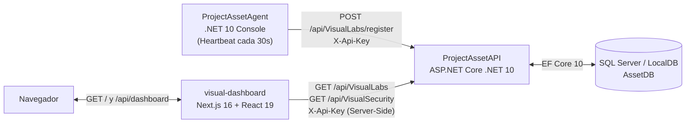

# ProjectAssetAPI

[](https://github.com/Hernanwin/ProjectAssetAPI-1.0.0v/actions/workflows/ci.yml)


Plataforma full-stack para el **inventario, monitoreo en tiempo real de dispositivos y registro de eventos de seguridad**. Combina una API REST en **ASP.NET Core (.NET 10)**, un agente multiplataforma de recolección con *heartbeat* periódico y un dashboard web moderno en **Next.js 16**.

---

## Características principales

- **Inventario sin duplicados (Upsert por Hostname):** el agente reporta periódicamente el equipo y actualiza IP, Sistema Operativo y marca de tiempo (`LastSeenUtc`) sobre el mismo registro.
- **Detección automática de estado (`Online` / `Offline`):** la API calcula dinámicamente si un dispositivo dejó de reportar según el umbral configurable (`HeartbeatTimeoutSeconds`).
- **Eventos de seguridad (`VisualSecurity`):** registro, filtrado por dispositivo o severidad (`Low`, `Medium`, `High`, `Critical`) y borrado en cascada ligado por clave foránea a `VisualLabs`.
- **Seguridad por API Key (`X-Api-Key`):** autenticación con comparación en tiempo constante (`CryptographicOperations.FixedTimeEquals`), validación estricta de DTOs y proxy server-side en Next.js para no exponer claves al navegador.
- **Agente resiliente:** ejecución continua con `PeriodicTimer`, modo de ejecución única (`--once`), cierre limpio con `Ctrl+C` y reintentos con *backoff* exponencial.
- **Dashboard interactivo:** KPIs en vivo, grilla de dispositivos con badges de estado, tabla de eventos de seguridad y auto-refresco configurable cada 15 segundos.
- **Pruebas automatizadas y CI:** suite de integración/unidad con **xUnit** + `WebApplicationFactory` y pipeline de **GitHub Actions** para `.NET` y `Next.js`.

---

## Arquitectura



---

## Estructura del proyecto

```text
ProjectAssetAPI/
├── .github/workflows/ci.yml        # Pipeline de CI (.NET build/test + Next.js tsc/lint/build)
├── ProjectAssetAPI.slnx            # Solución .NET 10
├── ProjectAssetAPI/                # Backend REST API
│   ├── Context/VisualDBContext.cs  # DbContext, índices únicos y relaciones FK
│   ├── Controllers/                # VisualLabsController y VisualSecurityController
│   ├── DTOs/                       # Contratos de entrada/salida validados
│   ├── Migrations/                 # Migraciones de Entity Framework Core
│   ├── Models/                     # Entidades VisualLab y VisualSecurity
│   ├── Options/                    # SecurityOptions (API Key y timeout de heartbeat)
│   ├── Security/                   # ApiKeyAuthenticationHandler
│   ├── Program.cs                  # Configuración de DI, Auth, CORS, Swagger y /health
│   └── ProjectAssetAPI.http        # Colección de pruebas HTTP lista para ejecutar
├── ProjectAssetAgent/              # Agente de monitoreo de equipos
│   ├── Models/                     # VisualLab y AgentOptions
│   ├── Services/                   # SystemCollector (Hostname/IP/OS) y ApiService (reintentos)
│   ├── Program.cs                  # Loop PeriodicTimer + modo --once
│   └── appsettings.json            # Configuración local del agente
├── ProjectAssetAPI.Tests/          # Pruebas automatizadas xUnit + InMemory DB
└── visual-dashboard/               # Frontend Next.js 16 + Tailwind v4 + shadcn/ui
    ├── app/                        # App Router (page.tsx, layout.tsx, api/dashboard/route.ts)
    ├── components/                 # DashboardClient y componentes shadcn/ui
    ├── lib/api.ts                  # Cliente server-side tipado hacia la API
    └── .env.example                # Plantilla de variables de entorno
```

---

## Stack tecnológico

| Módulo | Tecnologías |
| :--- | :--- |
| **Backend (`ProjectAssetAPI`)** | C#, .NET 10, ASP.NET Core, Entity Framework Core 10, SQL Server / LocalDB, Swashbuckle Swagger |
| **Agente (`ProjectAssetAgent`)** | C#, .NET 10, `HttpClient`, `PeriodicTimer`, `System.Net.NetworkInformation` |
| **Frontend (`visual-dashboard`)** | Next.js 16 (App Router + Turbopack), React 19, TypeScript 5, Tailwind CSS v4, shadcn/ui, Lucide Icons |
| **Testing & CI** | xUnit, `Microsoft.AspNetCore.Mvc.Testing`, EF Core InMemory, ESLint, GitHub Actions |

---

## Requisitos previos

- [.NET 10 SDK](https://dotnet.microsoft.com/download) (`10.0.x`)
- SQL Server LocalDB (`MSSQLLocalDB`) o una instancia de SQL Server
- [Node.js](https://nodejs.org/) `20+` y `npm`
- Herramienta CLI de EF Core (`dotnet tool install --global dotnet-ef`) para aplicar migraciones

---

## Puesta en marcha local

### 1. Clonar el repositorio

```bash
git clone https://github.com/Hernanwin/ProjectAssetAPI-1.0.0v.git
cd ProjectAssetAPI-1.0.0v
```

### 2. Crear / actualizar la base de datos

```bash
dotnet ef database update \
  --project ProjectAssetAPI/ProjectAssetAPI.csproj \
  --startup-project ProjectAssetAPI/ProjectAssetAPI.csproj
```

### 3. Iniciar la API (`ProjectAssetAPI`)

```bash
dotnet run --project ProjectAssetAPI/ProjectAssetAPI.csproj --launch-profile http
```

- **API:** `http://localhost:5000`
- **Swagger UI (Development):** `http://localhost:5000/swagger`
- **Health Check:** `GET http://localhost:5000/health`

> **Clave de desarrollo:** en `ProjectAssetAPI/appsettings.Development.json` viene preconfigurada la clave `dev-local-api-key-change-in-prod`. En producción, **nunca** subas secretos al repositorio: configura `Security__ApiKey` mediante variables de entorno o `dotnet user-secrets`.

### 4. Ejecutar el agente (`ProjectAssetAgent`)

**Modo continuo** (envía un *heartbeat* al iniciar y luego cada 30 segundos):

```bash
dotnet run --project ProjectAssetAgent/ProjectAssetAgent.csproj
```

**Modo único** (envía un reporte y finaliza):

```bash
dotnet run --project ProjectAssetAgent/ProjectAssetAgent.csproj -- --once
```

### 5. Iniciar el dashboard (`visual-dashboard`)

```bash
cd visual-dashboard
npm install
cp .env.example .env.local
npm run dev
```

Abre [http://localhost:3000](http://localhost:3000) en tu navegador.

---

## Configuración y variables de entorno

### Backend (`ProjectAssetAPI`)

| Clave / Variable de entorno | Descripción | Valor por defecto (Dev) |
| :--- | :--- | :--- |
| `ConnectionStrings__Connection` | Cadena de conexión a SQL Server | `Server=(localdb)\MSSQLLocalDB;Database=AssetDB;...` |
| `Security__ApiKey` | Clave esperada en el header `X-Api-Key` | `dev-local-api-key-change-in-prod` |
| `Security__HeartbeatTimeoutSeconds` | Segundos antes de marcar un equipo `Online` como `Offline` | `120` |
| `Cors__AllowedOrigins__0` | Orígenes permitidos para CORS | `http://localhost:3000` |

### Agente (`ProjectAssetAgent`)

Configurable en `ProjectAssetAgent/appsettings.json` o mediante variables de entorno:

| Variable | Descripción | Por defecto |
| :--- | :--- | :--- |
| `ASSET_API_URL` | URL base de `ProjectAssetAPI` | `http://localhost:5000` |
| `ASSET_API_KEY` | API Key para el encabezado `X-Api-Key` | `dev-local-api-key-change-in-prod` |
| `ASSET_HEARTBEAT_SECONDS` | Intervalo entre envíos (mínimo `5`) | `30` |

### Dashboard (`visual-dashboard/.env.local`)

Variables estrictamente del lado servidor (nunca expuestas al cliente):

| Variable | Descripción | Por defecto |
| :--- | :--- | :--- |
| `API_BASE_URL` | URL base de `ProjectAssetAPI` | `http://localhost:5000` |
| `API_KEY` | API Key enviada en el header `X-Api-Key` | `dev-local-api-key-change-in-prod` |

---

## Referencia de la API

Todos los endpoints `/api/*` requieren el encabezado `X-Api-Key: <tu-api-key>`.

| Método | Ruta | Auth | Descripción |
| :--- | :--- | :---: | :--- |
| `GET` | `/health` | No | Comprueba la salud del servicio |
| `GET` | `/api/VisualLabs` | Sí | Lista todos los dispositivos con estado calculado y conteo de eventos |
| `GET` | `/api/VisualLabs/{id}` | Sí | Obtiene el detalle de un dispositivo por ID |
| `POST` | `/api/VisualLabs/register` | Sí | Registra un dispositivo nuevo (`201`) o actualiza uno existente por `Hostname` (`200`) |
| `PUT` | `/api/VisualLabs/{id}` | Sí | Actualiza los datos o estado (`Online`, `Offline`, `Maintenance`) de un dispositivo |
| `DELETE` | `/api/VisualLabs/{id}` | Sí | Elimina un dispositivo y sus eventos de seguridad en cascada |
| `GET` | `/api/VisualSecurity` | Sí | Lista eventos de seguridad (filtros opcionales `?assetId=&severity=`) |
| `GET` | `/api/VisualSecurity/{id}` | Sí | Obtiene un evento de seguridad por ID |
| `POST` | `/api/VisualSecurity` | Sí | Registra un evento (`Low`, `Medium`, `High`, `Critical`) para un `AssetId` existente |
| `DELETE` | `/api/VisualSecurity/{id}` | Sí | Elimina un evento de seguridad |

### Ejemplos rápidos con `curl`

**Registrar / actualizar un dispositivo:**

```bash
curl -X POST http://localhost:5000/api/VisualLabs/register \
  -H "Content-Type: application/json" \
  -H "X-Api-Key: dev-local-api-key-change-in-prod" \
  -d '{
    "hostname": "LAB-PC-01",
    "ipAddress": "192.168.0.50",
    "operatingSystem": "Microsoft Windows 11 Pro"
  }'
```

**Registrar un evento de seguridad:**

```bash
curl -X POST http://localhost:5000/api/VisualSecurity \
  -H "Content-Type: application/json" \
  -H "X-Api-Key: dev-local-api-key-change-in-prod" \
  -d '{
    "assetId": 1,
    "eventType": "FailedLogin",
    "severity": "High",
    "description": "5 intentos fallidos consecutivos de inicio de sesión."
  }'
```

> También puedes probar todos los endpoints directamente desde Visual Studio o VS Code usando [ProjectAssetAPI/ProjectAssetAPI.http](ProjectAssetAPI/ProjectAssetAPI.http).

---

## Pruebas y verificación

### Solución .NET (Compilación y Tests xUnit)

```bash
dotnet build ProjectAssetAPI.slnx
dotnet test ProjectAssetAPI.slnx --verbosity normal
```

### Frontend Next.js (Tipos, Linter y Build)

```bash
cd visual-dashboard
npx tsc --noEmit
npm run lint
npm run build
```

---

## Roadmap sugerido

- [ ] Contenedores Linux + `docker-compose.yml` unificado (API + SQL Server + Dashboard).
- [ ] Métricas de hardware en el agente (uso de CPU, RAM y disco).
- [ ] Autenticación multiusuario con roles (JWT) para el panel web.
- [ ] Alertas en tiempo real vía SignalR / WebSockets y notificaciones por webhook.
